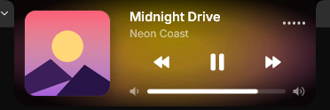
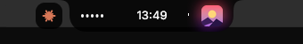
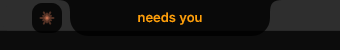

# Dynamic Island for Rainmeter

A notch-style Dynamic Island for Windows, built with [Rainmeter](https://www.rainmeter.net/). It hangs
from the top edge of the screen, shows the time, and comes alive when music plays or Claude Code is
working. The look and the motion follow [Bloom](https://github.com/SehajveerSingh2005/bloom) by
Sehajveer Singh: the same sizes, colours, font and spring physics, rebuilt from scratch for Rainmeter.


## What it does

| | |
|---|---|
|  | **Idle.** A 124x36 black notch with the clock, curving into the screen edge. At startup it plays Bloom's intro: a capsule springs up and turns into the notch. Middle-click starts a 25-minute focus round. It dims late at night and steps aside while a fullscreen game or video runs. |
| | **Hover.** The notch widens and shows the weather on the left and your next to-do on the right (a red box when it's overdue), like Bloom's status view, plus the money glance (bills still due, days to payday). When a shift or class starts within the hour and a half, the bus to catch replaces the weather, and ten minutes before it leaves a pulse reminds you. |
|  | **Music.** A 5-bar visualizer that reacts to what you hear, and the album cover with a soft glow; the notch takes a dark tint of the cover's colour, like Bloom's adaptive theme. Music playing on your phone (Spotify, through your status endpoint) shows too, with working controls. Five seconds after you pause, it goes back to the clock. |
| | **Calendar and focus timer.** Click the notch (or scroll on it) to open this month's calendar next to a focus timer: presets of 5, 15, 25 and 50 minutes, Start / Pause / Resume and reset. While it runs, the notch shows the time left, and when it ends you hear a chime and see "Time's up". Your next appointment (or else the next countdown) sits beside the month, with dots on those days, finished rounds go to your status endpoint's focus log, and the timer shows this week's total. |
| | **Home.** Scroll on to glowing Home Assistant tiles (through your status endpoint): switches you can tap, plus room climate, door, motion and phone battery; each glows in its own colour and flashes when it changes. Below that: today's chore with a Done button, CPU / RAM / GPU, ping and Pi-hole's blocked ads, today's screen time with your top apps, "Send clipboard to phone" and the system volume, like Bloom's command center. |
| | **Learn.** Scroll on to a word card from your vocab list: tap to see what it means, tap again for the next word. |
| | **Calls and recording.** In a Discord or Teams call the notch shows who and how long, with a mic button (the mic dot works as a mute button too). While Mixxx records a set, the right bubble shows a red REC timer. |
| | **DJ mode.** While Mixxx runs with the ClaudeDJ controller mapping, the notch shows both decks' BPM around the crossfader; click for the tracks, their positions and the crossfader. |
|  | **Player.** Click the album cover (or scroll while the calendar is open) for the player: cover, title (it scrolls when it's too long), artist, previous / play-pause / next and the system volume (click the bar to set it). After that, a click on the notch brings back whichever view you used last. Moving the mouse away closes it. |
|  | **Claude Code.** While a session runs, a bubble slides out beside the notch. It glows while Claude works and blinks when it needs you. When it's done it turns blue and stays blue until you look (hover the island), then turns green and fades away. Click it for the Claude panel: project, how long this turn has run, Read / Edit / Test / Done and the file or command it's on. |
|  | **Pulses.** For a few seconds the notch widens and says what happened: "needs you", "done", a mode switch, a battery change, a server that went down ("nextcloud down" in red, "nextcloud is back" in green), the internet dropping, a shop alarm, an upload that landed, the next shift with what to wear, the morning briefing (scrolling), and a bedtime nudge at 23:00. Long ones scroll. |
| | **Status bubble.** On the right, a bubble counts what waits for you on a status endpoint of your own (approvals and questions; a red "!" when a monitor is down). Click it for the details, answer buttons for the first question, and an "Open" button. It also lists the pull requests waiting for your merge. Bills due within three days and the next birthday (from 7:00, once a day) arrive as pulses. |

Width, height and the bubble move on springs with Bloom's constants (width 400/31, height 450/29),
the old content fades out before the new one fades in, and it all runs at 60 frames a second. When
nothing moves, the skin does almost no work.

## Requirements

- Windows 10/11 and [Rainmeter](https://www.rainmeter.net/) 4.5 or newer. It uses the Lua, AudioLevel
  and Win7Audio plugins that come with Rainmeter.
- The Inter font is included in `@Resources\Fonts` (SIL Open Font License), so there's nothing to install.
- Album covers need Python 3 with
  `pip install winrt-runtime winrt-Windows.Media.Control winrt-Windows.Storage.Streams winrt-Windows.Foundation pillow`.
  Without it the island shows an empty tile where the cover would be. The same helper fetches synced lyrics from
  [LRCLIB](https://lrclib.net) and the cover's tint.
- `@Resources\pcstate.py` (game mode, mic, screen time, GPU via `nvidia-smi`, internet, recording) needs
  `pip install pycaw` for the microphone. The word card reads `@Resources\Vocab.local.txt`
  (`word<TAB>part of speech<TAB>meaning<TAB>example` per line, not in git).

## Feeds (optional)

`@Resources\feeds.py` runs in the background, refreshes every 30 seconds and reads `@Resources\Feeds.local.json`, which stays out of git:

```json
{
  "lat": 51.51, "lon": -0.13,
  "hq_island_url": "http://hq.local:8090/api/island?fmt=txt&token=...",
  "hq_open_url": "https://hq.example.com"
}
```

`lat`/`lon` turn on the weather (Open-Meteo, no key). `hq_island_url` is any URL that answers with
`Key=Value` lines (`Approvals`, `Approval`, `Questions`, `Question`, `Incidents`, `Incident`, `Down`,
`DownNames`, `Todo`, `TodoDue`, `TodoOverdue`, `Leave`, `LeaveFor`, `LeaveIn`, `NextDep`, `Bill`, `BillIn`,
`Birthday`, `BirthdayIn`, `Countdowns`, `FocusWeek`, `QuestionId`, `QuestionOptions`, `Home`); leave it out
and the status bubble stays hidden. Answers, focus rounds and switch toggles are POSTed to the same URL
with `/act` added to its path (`do=answer|pomo|toggle`).

DJ mode needs `pip install mido python-rtmidi`. `@Resources\djstate.py` asks a Mixxx controller mapping on
the `ClaudeDJ` MIDI port for `STATUS` every 2 seconds while Mixxx runs. It opens and closes the port each
time and sends nothing else.

## Installation

1. Download or clone this repository.
2. Copy the folder into your Rainmeter skins folder, typically `Documents\Rainmeter\Skins\DynamicIsland`.
3. In Rainmeter, refresh the skin list and load `DynamicIsland.ini`. It centres itself at the top of
   the screen and stays on top.

## Claude Code

If you use [Claude Code](https://claude.com/claude-code), the island shows what it's doing:

| Spark in the bubble | Meaning |
|---|---|
| twinkling, soft glow | Claude is working |
| blinking, orange glow | Claude needs you (a permission prompt or a question) |
| blue | Claude is done and you haven't looked yet (stays up to 12 hours) |
| green, fading | you hovered the island, so it knows you've seen it |

Click the bubble (or scroll to it) for the Claude panel: the project folder, a timer for the current
turn, what it's doing (reading code, making changes, running tests, done, step n of 4) with a bar per
step, and the last file or command it touched.

The spark's colour is the permission mode, as in the Claude Code footer: orange for manual, teal for
plan, purple for accept edits, yellow for auto, pink for bypass. With several sessions open, the
island follows the most urgent one and doesn't jump between sessions that are equally busy.

Setup:

1. Copy `claude-code/claude-modes.py` to `~/.claude/hooks/` (Python 3 on your PATH).
2. Merge the `hooks` block from `claude-code/hooks.json` into `~/.claude/settings.json`, then open
   `/hooks` once in Claude Code (or restart it) so it picks them up.

The hook writes `~/.claude/claude-modes/status.json`, which `NowPlaying.ps1` reads every second. The
hooks run in the background, so Claude never waits for them. Without the hook the bubble stays hidden.

## How it works

- `DynamicIsland.ini`: the measures and meters. Everything inside the notch is clipped to its shape.
- `@Resources\Island.lua`: the springs, fades, title marquee and visualizer smoothing. It hands its
  results to the meters as variables and redraws only when something changed. It is saved as UTF-16, which makes Rainmeter hand it text as Unicode (song titles in any script, symbols).
- `@Resources\NowPlaying.ps1`: one background PowerShell that, every second, reads battery (WMI), microphone
  and camera use (registry) and the Claude Code status, and writes `NowPlaying.inc` for the skin. The
  media session (SMTC) is only read when the cover watcher says it changed (and every 5 s to be safe).
- `@Resources\cover.py watch`: a background Python that Windows tells about every music change. On a new
  track it renders the rounded tiles and the blurred glow behind the player (Pillow) right away, then
  wakes `NowPlaying.ps1`. Without it, `NowPlaying.ps1` polls twice a second and runs `cover.py` per track.
- `tools\island_guard.py`: optional guard (install once with `tools\install-guard.ps1`). Every 10 minutes and at logon it
  starts Rainmeter, loads the island or refreshes it when it was switched off or its poller died. A `guard.off`
  file next to it pauses it.
- `tools\measure-island.ps1`: logs the CPU, RAM and file writes of Rainmeter and these helpers for a few
  minutes, to compare before and after a change.

## Credits

Design and motion after [Bloom](https://github.com/SehajveerSingh2005/bloom) by Sehajveer Singh
(GPL-3.0). No Bloom code or images are used here: the sizes, colours and spring values were taken
from it and implemented again for Rainmeter. Font: [Inter](https://rsms.me/inter/) by Rasmus
Andersson (SIL Open Font License, see `@Resources\Fonts\OFL.txt`).

## License

MIT, see [LICENSE](LICENSE).
